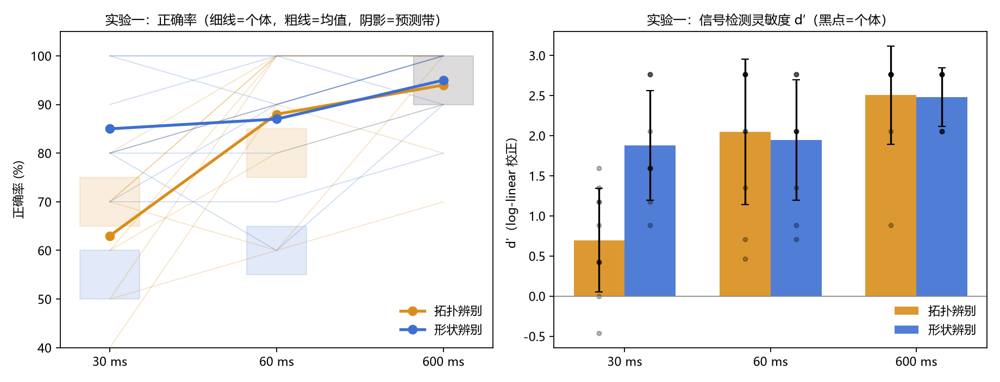
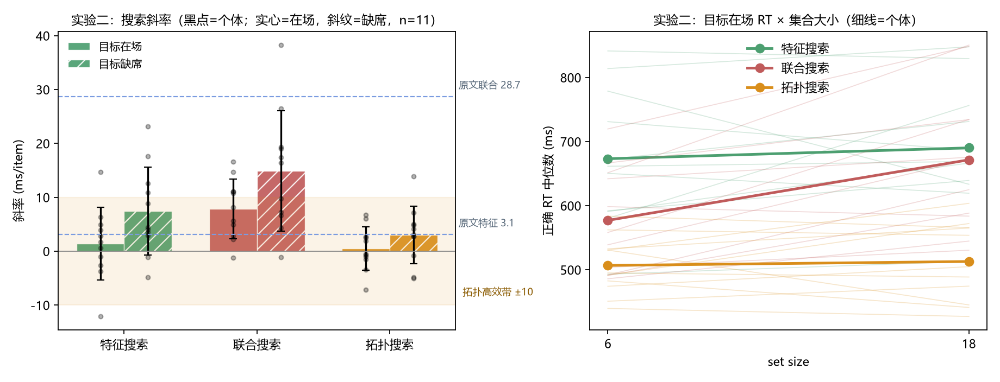

# 注意实验室 · 星夜启程（工程心理学 作业二）

> **公开链接（已发布，直接发给被试即可）**：https://attention-lab-bnu.app.workbuddy.host/?sharecode=SHUTHC7F2R
> 项目码（6 位，公开）：**`F2EMS2`**（下载密钥只保存在注意实验室页面，不写入本仓库）
> **运行方法（三选一）**：① 发上面这条链接，被试浏览器打开即做（推荐，HTTPS 下眼动也可用）；② 本地双击 `启动实验.bat`（自动起服务器，眼动可用）；③ 纯离线双击 `index.html`（可收数、上传正常，但眼动不可用）。

北京师范大学《工程心理学》作业二 · 「注意实验室」网页实验。从 W5–W8 经典注意实验中选取 **2 个**复现并各加入理论驱动的改进条件，收集 ≥ 5 名他人被试数据，与原论文对比。

---

## 一、实验一览

| 实验 | 复现出处 | 设计 | 理论驱动的改进 | 试次 |
|---|---|---|---|---|
| 实验一 `topo_soa`：拓扑 vs 形状辨别 | Chen (1982) *Science* 实验一（速示“相同/不同”判断） | 2（任务：拓扑辨别/形状辨别）× 3（SOA：30/60/600 ms）被试内 | 将单一 5 ms 速示改编为 **30/60/600 ms 时间进程**，检验拓扑优势是“阈值现象”还是“加工时程属性” | 60（每单元 10） |
| 实验二 `fit_topo_search`：视觉搜索 | Treisman & Gelade (1980) *Cognitive Psychology* 实验一（FIT） | 3（搜索条件：特征/联合/拓扑）× 2（set size：6/18）× 2（目标有无）被试内 | **新增拓扑搜索条件**（红圆环 vs 红实心圆，仅“洞”不同），检验拓扑差异是否 pop-out——FIT 前注意特征清单不含拓扑性质，是两理论的直接分歧点；特征与联合条件共用相同干扰项（绿色方 + 红色圆），排除干扰项异质性解释 | 120（每单元 10） |

两个实验同一被试连做，单人合计约 10–11 分钟。

## 二、预测（收数前注册，commit 先于数据）

**实验一**
- H1：名义 30 ms 条件下拓扑辨别正确率显著高于形状辨别（60 ms 为次要对比）。
- H2：任务 × SOA 交互显著，短暴露下拓扑优势大于 600 ms。
- 数值预测带：30 ms 拓扑 65–75%、形状 50–60%；60 ms 拓扑 75–85%、形状 55–65%；600 ms 两者 90–100%。
- 原文对照：Chen (1982) 5 ms 速示下环–圆“不同”报告率 64.5%，显著高于圆–方 43.5%、圆–三角 38.5%（n=6）。本研究为单图分类 + 多 SOA 改编，只比较结果模式，不复制其百分比。

**实验二**
- H1（复现）：联合搜索 target-present ΔRT（18−6）明显大于特征搜索；特征 ΔRT 接近 0。
- H2（检验改进条件）：拓扑理论预测拓扑 ΔRT 落入预设“高效搜索带”（±10 ms/item × 12 = ±120 ms）；FIT 的待检验推论为拓扑斜率为正且更接近联合搜索。
- 原文参考换算：特征 target-present ΔRT ≈ 37.2 ms（3.1 ms/item × 12），联合 ≈ 344.4 ms（28.7 × 12），联合 target-absent ≈ 805.2 ms（67.1 × 12）。本研究仅 6/18 两点，不检验完整线性函数。

普通差异检验不显著不等于等价；如需声称“高效搜索”，以预测带 + 探索性 TOST 为准。

## 三、被试间平衡（收数前冻结的分配表）

按被试编号（1–12，循环使用）查表，编号 0 为测试模式（数据加 `test_` 前缀）：

| 编号 | 代码 | 实验顺序 | 实验一 block 顺序 | 按键映射 | 拓扑搜索方向 | 实验二 block 排列 |
|---|---|---|---|---|---|---|
| 1 | A | 一→二 | 拓扑→形状 | F=肯定/J=否定 | 找圆环 | 特征→联合→拓扑 |
| 2 | B | 二→一 | 拓扑→形状 | F=否定/J=肯定 | 找实心圆 | 特征→拓扑→联合 |
| 3 | C | 一→二 | 形状→拓扑 | F=肯定/J=否定 | 找实心圆 | 联合→特征→拓扑 |
| 4 | D | 二→一 | 形状→拓扑 | F=否定/J=肯定 | 找圆环 | 联合→拓扑→特征 |
| 5 | E | 一→二 | 拓扑→形状 | F=否定/J=肯定 | 找圆环 | 拓扑→特征→联合 |
| 6 | F | 二→一 | 拓扑→形状 | F=肯定/J=否定 | 找实心圆 | 拓扑→联合→特征 |
| 7 | G | 一→二 | 形状→拓扑 | F=否定/J=肯定 | 找圆环 | 特征→联合→拓扑 |
| 8 | H | 二→一 | 形状→拓扑 | F=肯定/J=否定 | 找实心圆 | 特征→拓扑→联合 |
| 9 | I | 一→二 | 拓扑→形状 | F=否定/J=肯定 | 找实心圆 | 联合→特征→拓扑 |
| 10 | J | 二→一 | 拓扑→形状 | F=肯定/J=否定 | 找圆环 | 联合→拓扑→特征 |
| 11 | K | 一→二 | 形状→拓扑 | F=肯定/J=否定 | 找实心圆 | 拓扑→特征→联合 |
| 12 | L | 二→一 | 形状→拓扑 | F=否定/J=肯定 | 找圆环 | 拓扑→联合→特征 |

## 四、程序与关键控制

**共同**：注视点 250 ms → 刺激 → 反应 → 对错反馈 → ITI 500 ms → 下一试次；试次屏底部常驻键位提示卡片（键帽 F/J 在上、对应含义在下），防止被试忘记反应映射；每部分先练 6 题（反馈停留 0.9 秒），练习结束后出现确认页，由被试自主选择「再练一次」或「开始正式实验」；正式试次按键后同样显示对错反馈（0.8 秒，未按显示「超时」），错误/超时反馈附带正确答案文本，反馈 + 空屏 ITI + 注视点共同构成试次分隔；纯白刺激区（风格只留在外壳，不作混淆变量）；`performance.now()` 计时，`requestAnimationFrame` 帧对齐呈现，逐试次记录**实际**呈现时长（30 ms 名义值在 60 Hz 下约 2 帧 ≈ 33 ms，分析以实测为准）。反馈在反应记录之后呈现，不影响 RT 测量。

**实验一**：目标（30/60/600 ms）→ 随机黑白噪声掩蔽 100 ms → 反应上限 2000 ms，超时记错误。拓扑 block 判断有洞/无洞（圆环、方环、实心圆、实心方，轮廓随机，形状为无关维度）；形状 block 判断圆/方（均为实心，排除拓扑线索）。圆环外径 D、孔径 D/2；实心方边长 ≈ 0.886D（与圆等面积）。诚实声明：同外径下圆环墨量必然少于实心圆（≈75%），“等墨量”在有洞前提下不可能成立，墨量差异作为替代解释在讨论中处理，不声称只操纵了拓扑。

**实验二**：搜索阵列呈现至反应，上限 2500 ms，超时记错误。6×3 隐形网格，项目基准 70 px、间距 ≥ 90 px、抖动 ≤ ±8 px。拓扑条件目标恒为墨量较少一侧的对应安排（找圆环方向为不利性控制：若仍平坦斜率，亮度/墨量解释陷入不利）；两个搜索方向在被试间平衡并分别报告。

## 五、数据与隐私

- 每做完一个实验，`fetch` POST 一次到 `https://attention-lab-production.up.railway.app/api/hw2/submit`（experiment 字段：`topo_soa` / `fit_topo_search`，测试加 `test_` 前缀）；失败有提示并可点「下载数据备份 (CSV)」。
- 仅使用匿名编号（P01…），不收集姓名学号；被试可拒绝摄像头而不影响参加。
- 断点备份仅写入被试本机浏览器的 localStorage（不上传、不跨设备），两部分数据均上传成功后自动删除，舰桥页也可一键清除。
- 试次字段：`trial, block, soa/n/target, dur, stim, resp, key, corr, rt, to`（实验二另有 `ttype`），眼动启用时另附 `gz_n, gz_v, gz_off` 三个**汇总**字段（不存逐点坐标之外的原始视频任何内容）。

## 六、排除规则与统计计划（收数前注册）

- 被试剔除仅限：正式试次超时 > 20%，或总正确率精确二项检验显著低于 50%；不因结果不符合预期删人删试次，所有剔除/补测记录报告。
- 实验一：2×3 重复测量交互（偏 η²），30 ms 主要配对对比、60 ms 次要对比，Holm 校正，报告 Cohen's dz 与差值 CI；d′（log-linear 校正）作敏感性分析。
- 实验二：仅正确且 200–2500 ms 的 RT，单元中位数；ΔRT = M(RT18) − M(RT6)（两点估计，不检验完整线性）；3 条件单因素重复测量 + Bonferroni 两两比较，报告偏 η²、Cohen's dz 与斜率差 CI；拓扑–特征可补 ±10 ms/item 探索性 TOST；同时报告正确率与超时率（联合大量超时时说明删截低估）。

## 七、加分模块完成状态

| 模块 | 状态 |
|---|---|
| 公开链接 | ✅ 已发布：https://attention-lab-bnu.app.workbuddy.host/?sharecode=SHUTHC7F2R （HTTPS，见本文件首行） |
| WebGazer 眼动 | 已实现（本地 `assets/vendor/webgazer/webgazer.js` v3，自托管不依赖 CDN；需 localhost/HTTPS，file:// 自动跳过；**9 点校准 × 每点点击 5 次**，60 秒硬上限，失败不阻断核心实验；**基于 MediaPipe FaceMesh 同步做头部姿势检测**（yaw/pitch/roll 相对基线偏离写入各试次 CSV 的 `hd_*` 列）；全程**不向被试显示红点/注视轨迹**，注视数据仅内部记录用于离屏与头动质量控制，单独报告有效人数） |
| 模型可视化 | 已实现（结束页「查看我的结果」：实验一 SOA 预测带图、实验二 ΔRT 文献参考线与 ±120 ms 高效搜索带；预测配置收数前 commit，实测只更新观察层） |
| ≥ 10 名被试 | ✅ 达成（2026-11-08 收数：两实验各 11 人，实验一按预案剔除 P09 后有效 10 人） |
| 与全班数据对比 | 已实现（结果页按钮拉取 `GET /api/hw2/data?project=` 同项目匿名数据，同一公式计算均值并叠加虚线；数据未开放时显示获取失败，不虚构对比） |

**GitHub Pages 部署五步**：① 仓库设为 Public（Settings → General → Danger Zone）；② 入口文件命名 `index.html` 放仓库根目录并 push；③ Settings → Pages → Deploy from a branch → `main` / `/ (root)`；④ 等 1–2 分钟打开生成的链接自测一遍，确认显示“已提交”；⑤ 把链接写回本 README 第一行并填到仓库 About 的 Website 栏。

## 八、文件清单

```
实验网站/
├── index.html                    完整实验（外壳 + 两实验 + 上传 + 可视化，单文件）
├── 启动实验.bat                  一键本地服务器启动器（眼动必需，双击即可）
├── README.md                     本文件
├── 主试执行手册.md               主试流程与故障处理
├── 被试招募文案.md               招募话术（含知情同意要点）
├── docs/
│   ├── 作业二_结果与讨论报告.md  完整版结果报告（含个体数据附表）
│   └── data/                     原始数据 CSV（注意实验室收数接口导出）
└── assets/
    ├── bg.png                    星夜背景图（界面外壳）
    ├── fonts/                    马善政楷书 / 站酷庆科黄油体（OFL 开源字体）
    ├── results/                  最终结果图（图1 图2，本文件第九节引用）
    └── vendor/webgazer/          WebGazer v3（GPLv3/LGPL，本地眼动，可选模块）
        └── mediapipe/face_mesh/  FaceMesh 模型（wasm/binarypb，纯本站加载，无 CDN 依赖）
```

## 九、结果与讨论（2026-11-08 收数后完成）

**数据**：项目码 F2EMS2，经注意实验室接口收数，2026-11-08 21:48 导出（清理后 1980 行 = 11 人 × 180 试次；测试记录 `test_` 前缀与仅完成实验二、编号不在平衡表内的 P22 已移除）。漏反应按错误计入正确率、不入 RT 分析；30 ms 档实测呈现 36.2 ms（60 Hz 下 ≈2 帧），符合量化预期。**实验一 11 人，P09 在 600 ms 档两任务正确率 0–10%（二项检验 p ≤ .011，远低于机会）按收数前预案剔除，有效 10 人**；**实验二 11 人**，无人达到剔除标准。

**实验一（拓扑 vs 形状的时间进程，n=10）**——正确率：拓扑 63.0 / 88.0 / 94.0%（30/60/600 ms），形状 85.0 / 87.0 / 95.0%。

| 假设 | 结果 | 判定 |
|---|---|---|
| H1：30 ms 拓扑 > 形状 | Δ = **−22.0%**，t(9) = −3.84，p = .004，dz = −1.21（方向相反）；60 ms：Δ = +1.0%，p = .758 | 不支持 |
| H2：任务 × SOA 交互 | F(2,18) = 3.33，p = .059 | 不支持（边缘） |

形状任务 30 ms 已达 85%（校准目标 50–60%，预期带外），难度校准失败构成主要混淆（任务集 4 图形 vs 2 图形不对称）；拓扑 d′ 达到形状同等水平需更长暴露（0.70 → 2.05 vs 30 ms 已 1.88），模式与「时间优先性」相反。结论限定为：**在未成功校准形状难度的条件下，拓扑辨别未表现出时间优势**——非对拓扑优先性的证伪（详见完整报告 §5.1）。

**实验二（FIT 复现 + 拓扑 pop-out 改进条件，n=11）**——目标在场斜率（ms/item）：特征 1.4、联合 7.9、拓扑 0.5；缺席:在场比 1.89（≈ 序列自我终止的 2:1）。

| 假设 | 结果 | 判定 |
|---|---|---|
| H1（复现 FIT） | 特征 ≈ 0（与原文 3.1 同量级）；联合陡于特征（Bonferroni 校正后 p = .103，未达显著，dz = −0.74）；比值 1.89（原文 2.34）；条件主效应 F(2,20) = 5.59，p = .012 | 部分支持 |
| H2（改进条件：拓扑 pop-out） | 拓扑 vs 特征 p = 1.000（dz = −0.13）；拓扑 vs 联合 Δ = −7.4，p = .039（dz = −0.91） | **支持** |

**核心发现**：拓扑差异（红圆环 vs 红实心圆，仅「洞」不同）产生与基本特征同型的 pop-out，显著小于联合搜索——支持「洞的有无」属前注意阶段可提取的拓扑性质（拓扑性质知觉理论），不符 FIT 的推论。墨量替代解释陷入不利：目标恒为墨量较少一侧（≈75%），若按局部亮度逻辑本应更难检出，实际斜率平坦且正确率 98–99%（论证见完整报告 §5.3）。

**两实验整合**：注意维度（实验二）拓扑差异前注意可提取；时间维度（实验一）因难度校准失败无法检验时间优先性——分裂模式与设计文档 1.2 的「两实验检验力不对称」预判及 2.8 退路预案一致。局限：小样本两点斜率估计、未做球形校正、30 ms 实际 36 ms（长于 Chen 1982 的 5 ms）、墨量未完全匹配。





> 完整版（含全部表格、个体数据附表、逐条讨论）：本仓库 `docs/作业二_结果与讨论报告.md`，原始数据在 `docs/data/`；分析脚本 `analyze_report.py`（numpy/scipy/pandas）随作业提交。被试端结果页（结束页「查看我的结果」）已内置预测带与实测对比，可用「全班对比」按钮拉取同项目匿名数据叠加虚线。

## 十、AI 使用说明

本项目的实验设计文档、网页代码（HTML/CSS/JavaScript）与 README 在 AI 助手（Trae/Kimi）协作下完成：理论选择、假设与预测、平衡表、排除规则与统计计划由本人确定；AI 协助完成代码实现、图表绘制与文字整理。所有预测与分析计划均在收数前 commit。原始数据来自真实匿名被试，未使用任何脚本生成或修改数据。

## 参考文献

- Chen, L. (1982). Topological structure in visual perception. *Science, 218*(4573), 699–700. https://doi.org/10.1126/science.7134969
- Chen, L. (2005). The topological approach to perceptual organization. *Visual Cognition, 12*(4), 553–637. https://doi.org/10.1080/13506280444000256
- Treisman, A. M., & Gelade, G. (1980). A feature-integration theory of attention. *Cognitive Psychology, 12*(1), 97–136. https://doi.org/10.1016/0010-0285(80)90005-5
- Zhou, K., Luo, H., Zhou, T., Zhuo, Y., & Chen, L. (2010). Topological change disturbs object continuity in attentive tracking. *PNAS, 107*(50), 21920–21924. https://doi.org/10.1073/pnas.1010919108

## 变更记录

- 2026-11-07（收数前）：依据程序实际实现校正本文档参数——实验一反应上限 1200→2000 ms、实验二 1700→2500 ms、ITI 250→500 ms、RT 过滤窗 200–1700→200–2500 ms（指导语文案此前已按 2000/2500 ms 呈现，预测带不受反应窗影响）；新增切窗次数（blur）meta 字段说明。同期程序侧修复：全班对比排除 test_ 前缀测试数据、图2全班均值改虚线参考线、CSV 导出补 participant/condition/meta 列、界面令牌与用色按《风格设计规范 v2.1》收敛。
- 2026-11-07（收数前 · 第二轮）：补齐设计审查遗留项——① **localStorage 断点备份**：每完成一个正式试次即整包快照（编号/条件/meta/两部分试次数据，仅存被试本机浏览器，不上传），中途刷新或崩溃后舰桥页出现「下载备份 CSV / 清除备份」提示条；不自动续跑，避免破坏平衡设计与编号归属；两部分均上传成功后自动清除。② 结果页增加过渡文案「离开驾驶舱，进入分析室」。③ CSV 单元格增加逗号/引号/换行转义（csvCell）。
- 2026-11-07（v1.1.0）：① **试次屏按键卡下方新增正确答案示意图**——E1 拓扑条件画「圆环+方环 / 实心圆+实心方」，E1 形状条件画「圆 / 方」，E2 按条件画目标样例（特征=蓝圆+红三角、联合=绿圆、拓扑=红圆环或红实心圆依被试方向），无目标侧标注「没有这类图形」；图标随 F/J 键位映射自动交换。② **眼动可用了**：补 `webgazer.params.faceMeshSolutionPath` 指向本地 `assets/vendor/webgazer/mediapipe/face_mesh`（此前默认相对路径 404，摄像头亮但模型永不就绪，页面卡在加载）；校准页新增「跳过眼动」按钮 + 45 秒硬超时；加载中文案提示授权。③ **file:// 说明**：直接双击 `index.html` 时隐藏眼动选项并提示改用 `启动实验.bat`（浏览器禁止 file:// 加载 wasm）。④ 舰桥页页脚显示版本号。
- 2026-11-07（v1.1.0 · 发布）：已发布为在线链接 `https://attention-lab-bnu.app.workbuddy.host/?sharecode=SHUTHC7F2R`（HTTPS）。实测：素材/字体正常、上传接口 200、眼动模型 3 秒加载完成、校准 7 秒通过。被试只需点链接，不再需要文件夹与 Python；招募文案与主试手册同步改为"发链接"为默认方案。
